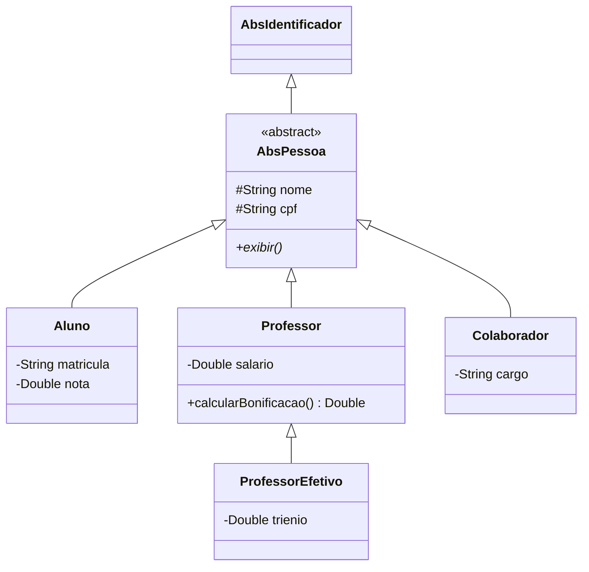

# 🎓 TechAcademy

Sistema acadêmico em **Java**, executado no terminal, feito para praticar **orientação a objetos** de ponta a ponta: hierarquia de classes, classes abstratas, generics e o padrão **DAO** com um banco de dados simulado em memória.

> 🚧 **Status: em desenvolvimento.** O CRUD de colaboradores está funcionando e demonstrado no `App`. Os demais módulos estão descritos em [Limitações e próximos passos](#-limitações-e-próximos-passos).

## ✨ O que o projeto demonstra

| Conceito | Onde aparece |
| --- | --- |
| **Herança** | `AbsIdentificador` → `AbsPessoa` → `Aluno`, `Professor`, `Colaborador`; e `Professor` → `ProfessorEfetivo` |
| **Classes e métodos abstratos** | `AbsPessoa.exibir()`, `AbsGenericDAO<T>`, `AbsGenericFakeDB<T>` |
| **Polimorfismo** | Cada pessoa sobrescreve `exibir()` com os seus próprios campos |
| **Generics** | `AbsGenericDAO<T>` e `AbsGenericFakeDB<T>` servem a qualquer entidade |
| **Padrão DAO** | Acesso aos dados isolado em `DAO/`, longe do `App` |
| **Encapsulamento** | Atributos protegidos/privados com getters e setters |
| **Regra de negócio** | `Professor.calcularBonificacao()` (10% do salário) |

## 🧱 Arquitetura



O acesso aos dados segue duas camadas, ambas genéricas:

```
App  →  DAO (browse, Read, Add, Edit, Delete)  →  FakeDB (lista em memória)
```

Os métodos seguem o padrão **BREAD** (Browse, Read, Edit, Add, Delete) em vez do CRUD tradicional.

## 📁 Estrutura

```
src/
├── App.java            # demonstração do CRUD de colaboradores
├── MenuAluno.java      # cadastro de aluno pelo terminal
├── Dominio/            # entidades (AbsIdentificador, AbsPessoa, Aluno, Professor, ...)
├── DAO/                # AbsGenericDAO<T> e DAOs concretos
└── FakeDB/             # bancos simulados em memória, com dados de exemplo
```

## ▶️ Como executar

Requisito: **Java 21 ou superior** (o código usa `ArrayList.getLast()`).

```bash
git clone https://github.com/oimanum/Projeto---TechAcademy.git
cd Projeto---TechAcademy

javac -encoding UTF-8 -d bin -sourcepath src src/App.java
java -cp bin App
```

Funciona igual no Linux, macOS e Windows. Também dá para abrir a pasta no VS Code com o *Extension Pack for Java* e executar o `App.java`.

## 🖥️ Exemplo de saída

O `App` lista os colaboradores, adiciona um (o DAO gera o próximo código), edita, apaga e lista de novo a cada etapa:

```text
--- ADD ---
...
Código: 106
Nome: Camila Rocha
CPF: 13333333300
Cargo: Analista de Sistemas

Camila Rocha passou cargo de Analista de Sistemas para Bruno Lima

--- EDIT ---
...
Código: 106
Nome: Bruno Lima
CPF: 22222222200
Cargo: Analista de Sistemas

Registro de código 106 apagado com sucesso!
```

## 🔧 Limitações e próximos passos

O projeto está em evolução. O que ainda falta:

- [ ] Criar o `AlunoDAO` (o `AlunoFakeDB` já existe)
- [ ] Ligar o `MenuAluno` ao `App` para ter um menu interativo
- [ ] Persistir os dados em um banco de verdade (hoje tudo vive em memória e some ao encerrar)
- [ ] Adicionar testes automatizados dos DAOs

## 🛠️ Tecnologias

`Java 21` · `POO` · `Generics` · `Padrão DAO`

## 👩‍💻 Autora

**Emanuelly Maciel** · [LinkedIn](https://www.linkedin.com/in/emanuelly-maciel-762153357/) · [GitHub](https://github.com/oimanum)
