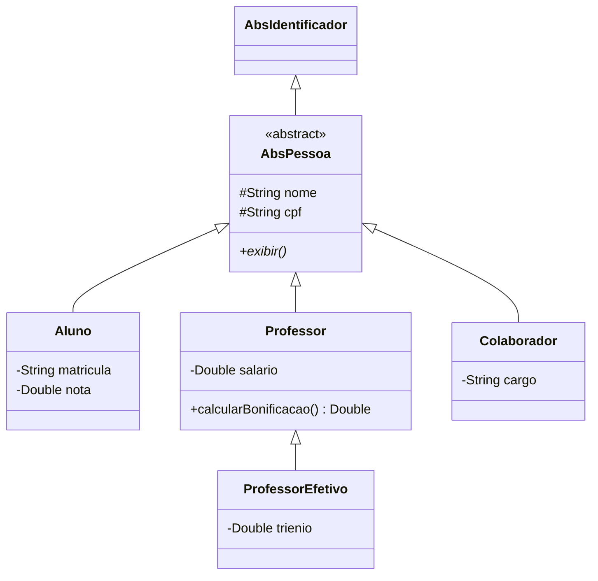

# 🎓 TechAcademy

Sistema acadêmico em **Java**, executado no terminal, feito para praticar **orientação a objetos** de ponta a ponta: hierarquia de classes, classes abstratas, generics, o padrão **DAO** com um banco de dados simulado em memória e uma arquitetura em **camadas** (Visão → Serviço → DAO → dados).

> 🚧 **Status: em desenvolvimento (V1.1).** Já existe um menu interativo de colaboradores com as opções *Listar* e *Pesquisar por código*. As demais opções do menu e os outros módulos estão descritos em [Limitações e próximos passos](#-limitações-e-próximos-passos).

## ✨ O que o projeto demonstra

| Conceito | Onde aparece |
| --- | --- |
| **Herança** | `AbsIdentificador` → `AbsPessoa` → `Aluno`, `Professor`, `Colaborador`; e `Professor` → `ProfessorEfetivo` |
| **Classes e métodos abstratos** | `AbsPessoa.exibir()`, `AbsGenericDAO<T>`, `AbsGenericFakeDB<T>`, `AbsGenericSrv<T>`, `AbsMenu`, `AbsVisao` |
| **Polimorfismo** | Cada pessoa sobrescreve `exibir()` com os seus próprios campos |
| **Generics** | DAO, serviço e banco simulado são genéricos e servem a qualquer entidade |
| **Arquitetura em camadas** | `Visao/` (menus) → `Servico/` (regras) → `DAO/` (acesso a dados) → `FakeDB/` (dados em memória) |
| **Padrão DAO** | Acesso aos dados isolado em `DAO/`, longe da interface |
| **Encapsulamento** | Atributos protegidos/privados com getters e setters |
| **Regra de negócio** | `Professor.calcularBonificacao()` (10% do salário) |

## 🧱 Arquitetura



O fluxo de uma operação atravessa quatro camadas, e cada uma só conhece a seguinte:

```
Visao (ColaboradorMenu)  →  Servico (ColaboradorSrv)  →  DAO (ColaboradorDAO)  →  FakeDB (lista em memória)
```

Os métodos de acesso seguem o padrão **BREAD** (Browse, Read, Edit, Add, Delete) em vez do CRUD tradicional. No serviço, os mesmos conceitos aparecem com nomes de negócio: `Listar`, `Buscar`, `Incluir`, `Alterar` e `Excluir`.

## 📁 Estrutura

```
src/
├── App.java            # demonstração direta do DAO de colaboradores (sem menu)
├── MenuAluno.java      # cadastro de aluno pelo terminal
├── Dominio/            # entidades (AbsIdentificador, AbsPessoa, Aluno, Professor, ...)
├── DAO/                # AbsGenericDAO<T> e ColaboradorDAO
├── FakeDB/             # bancos simulados em memória, com dados de exemplo
├── Servico/            # AbsGenericSrv<T> e ColaboradorSrv
└── Visao/              # App (ponto de entrada), AbsMenu, ColaboradorMenu e classes de teste
```

## ▶️ Como executar

Requisito: **Java 21 ou superior** (o código usa `ArrayList.getLast()`).

```bash
git clone https://github.com/oimanum/Projeto---TechAcademy.git
cd Projeto---TechAcademy

javac -encoding UTF-8 -d bin -sourcepath src src/Visao/App.java
java -cp bin Visao.App
```

Funciona igual no Linux, macOS e Windows. Também dá para abrir a pasta no VS Code com o *Extension Pack for Java* e executar o `Visao/App.java`.

Para ver a demonstração do DAO sem menu (adiciona, edita e apaga um colaborador), use o `App` da raiz:

```bash
javac -encoding UTF-8 -d bin -sourcepath src src/App.java
java -cp bin App
```

## 🖥️ Exemplo de saída

O menu de colaboradores lista os registros e pesquisa por código (aqui, a opção 1 e depois a opção 2 com o código 103):

```text
---- Menu [COLABORADOR] ----
1 - Listar
2 - Pesquisar por Código
3 - Incluir
4 - Alterar
5 - Excluir
9 - Voltar
Selecione uma opção:

***** LISTAR COLABORADOR *****
Código: 101
Nome: Matheus Souza
CPF: 1234567890
Cargo: Estagiario
...

***** PESQUISAR COLABORADOR POR CÓDIGO*****
Informe um código: 103
Código: 103
Nome: Paulo Santos
CPF: 1234567892
Cargo: Jovem Aprendiz
```

## 🔧 Limitações e próximos passos

O projeto está em evolução. O que ainda falta:

- [ ] Implementar no menu as opções **Incluir**, **Alterar** e **Excluir** (a camada de serviço e o DAO já oferecem as operações)
- [ ] Tratar a pesquisa por um código que não existe (hoje o menu não verifica o resultado vazio)
- [ ] Criar o `AlunoDAO` (o `AlunoFakeDB` já existe) e menus para aluno e professor
- [ ] Readaptar `ProfessorDAO` e `ProfessorEfetivoDAO`, da V1, ao método `Browse()`
- [ ] Persistir os dados em um banco de verdade (hoje tudo vive em memória e some ao encerrar)
- [ ] Adicionar testes automatizados dos DAOs e dos serviços

## 🛠️ Tecnologias

`Java 21` · `POO` · `Generics` · `Padrão DAO` · `Arquitetura em camadas`

## 👩‍💻 Autora

**Emanuelly Maciel** · [LinkedIn](https://www.linkedin.com/in/emanuelly-maciel-762153357/) · [GitHub](https://github.com/oimanum)
