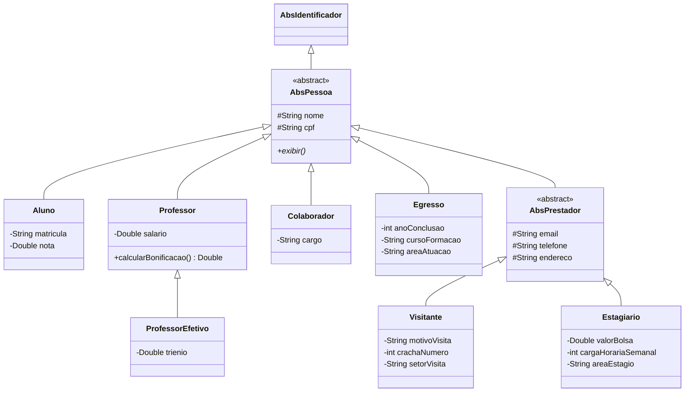

# 🎓 TechAcademy

Sistema acadêmico em **Java**, executado no terminal, feito para praticar **orientação a objetos** de ponta a ponta: hierarquia de classes, classes abstratas, generics, o padrão **DAO** com um banco de dados simulado em memória e uma arquitetura em **camadas** (Visão → Serviço → DAO → dados).

> ✅ **Versão atual: V1.2** (pasta `V1.2 - TechAcademy`). A V1.1 continua no repositório como histórico.

## 🆕 Novidades da V1.2 (Entrega 06)

- **`Egresso`**: nova subclasse de `AbsPessoa` (ano de conclusão, curso de formação e área de atuação).
- **`AbsPrestador`**: nova superclasse abstrata, filha de `AbsPessoa`, com `email`, `telefone` e `endereco`.
- **`Visitante`** e **`Estagiario`**: subclasses concretas de `AbsPrestador`.
- Para cada uma das três entidades novas: **`FakeDB`** com dados iniciais, **`DAO`**, **`Srv`** (serviço) e uma **classe de teste** (`EgressoTest`, `VisitanteTest`, `EstagiarioTest`).
- **`VisitanteMenu`**: menu interativo com *Cadastrar, Listar Todos, Buscar por Código, Editar, Excluir* e *Sair*.
- **`AbsMenu.lerInteiro()`**: se o usuário digitar letras onde se espera um número, o menu avisa e pergunta de novo (sem `try/catch`).
- **`ColaboradorMenu`** corrigido: `break` que faltava no `case 2` e tratamento de código inexistente.
- **VS Code**: pasta `.vscode` com configurações e tarefas para rodar o projeto em UTF-8.

## ✨ O que o projeto demonstra

| Conceito | Onde aparece |
| --- | --- |
| **Herança em vários níveis** | `AbsIdentificador` → `AbsPessoa` → `AbsPrestador` → `Visitante` / `Estagiario`; `AbsPessoa` → `Aluno`, `Professor`, `Colaborador`, `Egresso`; `Professor` → `ProfessorEfetivo` |
| **Classes e métodos abstratos** | `AbsPessoa.exibir()`, `AbsPrestador`, `AbsGenericDAO<T>`, `AbsGenericFakeDB<T>`, `AbsGenericSrv<T>`, `AbsMenu`, `AbsVisao` |
| **Polimorfismo** | Cada pessoa sobrescreve `exibir()` com os seus próprios campos |
| **Generics** | DAO, serviço e banco simulado são genéricos e servem a qualquer entidade |
| **Arquitetura em camadas** | `Visao/` (menus) → `Servico/` (regras) → `DAO/` (acesso a dados) → `FakeDB/` (dados em memória) |
| **Padrão DAO** | Acesso aos dados isolado em `DAO/`, longe da interface |
| **Encapsulamento** | Atributos `protected` nas superclasses e `private` nas subclasses, com getters e setters |
| **Regra de negócio** | `Professor.calcularBonificacao()` (10% do salário) |

## 🧱 Arquitetura



O fluxo de uma operação atravessa quatro camadas, e cada uma só conhece a seguinte:

```
Visao (VisitanteMenu)  →  Servico (VisitanteSrv)  →  DAO (VisitanteDAO)  →  FakeDB (lista em memória)
```

Os métodos de acesso seguem o padrão **BREAD** (Browse, Read, Edit, Add, Delete) em vez do CRUD tradicional. No serviço, os mesmos conceitos aparecem com nomes de negócio: `Listar`, `Buscar`, `Incluir`, `Alterar` e `Excluir`.

## 📁 Estrutura

```
V1.2 - TechAcademy/ProjetoTechAcademy/
├── .vscode/            # configurações, tarefas e execuções em UTF-8
└── src/
    ├── App.java        # demonstração direta do DAO de colaboradores (sem menu)
    ├── MenuAluno.java  # cadastro de aluno pelo terminal
    ├── Dominio/        # entidades (AbsPessoa, AbsPrestador, Egresso, Visitante, Estagiario, ...)
    ├── DAO/            # AbsGenericDAO<T> e um DAO por entidade
    ├── FakeDB/         # bancos simulados em memória, com dados de exemplo
    ├── Servico/        # AbsGenericSrv<T> e um serviço por entidade
    ├── Teste/          # EgressoTest, VisitanteTest e EstagiarioTest
    └── Visao/          # App (ponto de entrada), AbsMenu, VisitanteMenu, ColaboradorMenu, ...
```

## ▶️ Como executar

Requisito: **Java 21 ou superior** (o código usa `ArrayList.getLast()`).

Compile sempre a partir da pasta `src`, para o `javac` achar os pacotes:

```bash
git clone https://github.com/oimanum/Projeto---TechAcademy.git
cd "Projeto---TechAcademy/V1.2 - TechAcademy/ProjetoTechAcademy/src"

javac -encoding UTF-8 -d ../bin -sourcepath . Visao/App.java
java -cp ../bin Visao.App
```

Para rodar um dos testes (troque o nome pelo teste desejado):

```bash
javac -encoding UTF-8 -d ../bin -sourcepath . Teste/VisitanteTest.java
java -cp ../bin Teste.VisitanteTest
```

### No VS Code

1. Abra a pasta `ProjetoTechAcademy` (a que contém a `src`) com **File → Open Folder**.
2. Instale o *Extension Pack for Java*.
3. Aperte **Ctrl+Shift+B** para abrir o menu de Visitante, ou use **Terminal → Run Task...** para escolher os testes.

As tarefas (`.vscode/tasks.json`) mudam o terminal para UTF-8 antes de rodar, para os acentos saírem corretos no Windows.

## 🖥️ Menu do Visitante

```text
---- Menu [VISITANTE] ----
1 - Cadastrar
2 - Listar Todos
3 - Buscar por Código
4 - Editar
5 - Excluir
6 - Sair
Selecione uma opção:
```

- **Cadastrar**: pede os dados pelo teclado e chama `Incluir()` do serviço; o código é gerado automaticamente.
- **Editar**: mostra os dados atuais e pede os novos.
- **Excluir**: localiza pelo código e pede confirmação (S/N).
- Código inexistente e entradas inválidas (letras no lugar de números) são tratados sem quebrar o programa.

## 🧪 Testes

Cada entidade nova tem uma classe executável em `Teste/` que passa por listar, buscar, incluir, alterar, excluir e buscar um código inexistente.

## 🔧 Limitações e próximos passos

- [ ] Implementar no menu de colaboradores as opções **Incluir**, **Alterar** e **Excluir** (o serviço e o DAO já oferecem as operações)
- [ ] Criar menus para `Egresso`, `Estagiario`, aluno e professor
- [ ] Criar o `AlunoDAO` (o `AlunoFakeDB` já existe) e readaptar `ProfessorDAO` e `ProfessorEfetivoDAO`, da V1, ao método `Browse()`
- [ ] Persistir os dados em um banco de verdade (hoje tudo vive em memória e some ao encerrar)
- [ ] Trocar os testes executáveis por testes automatizados
- [ ] Os acentos dependem da codificação do terminal; no Windows, use as tarefas do VS Code ou rode `chcp 65001` antes

## 🛠️ Tecnologias

`Java 21` · `POO` · `Generics` · `Padrão DAO` · `Arquitetura em camadas`

## 👩‍💻 Autora

**Emanuelly Maciel** · [LinkedIn](https://www.linkedin.com/in/emanuelly-maciel-762153357/) · [GitHub](https://github.com/oimanum)
